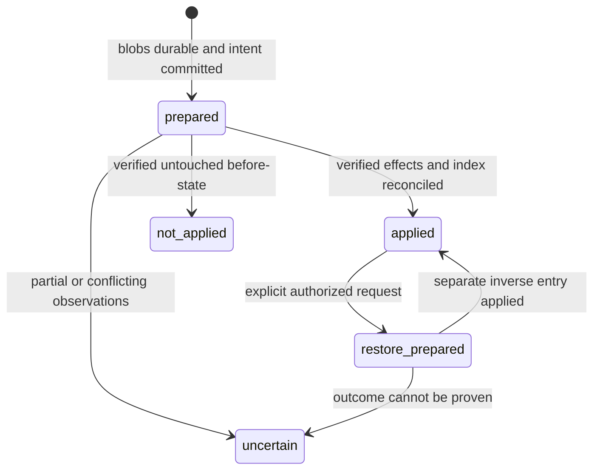

# F31: local change history and confirmed Restore with conflict preflight

Status: proposed design for Claude's review, 2026-11-09. Documentation only; no
runtime changes, migrations, model calls or retention cleanup are enabled by this PR.
Implementation stays at F31's existing queue position. F33 #88 and F25 #89 are independent.

## Purpose and scope

Keep exact before/after bytes for files changed by Nuru, outside the vault, so the
user can inspect and undo a recorded change without losing later work. Cover create,
append, replace, rename, move, archive and trash, plus secondary files those actions
create or change. Support a selected entry and a turn's changes, newest first.
A restore is another recorded mutation and can itself be undone under the same preflight and confirmation rules.

Use standard-library SQLite and SHA-256-addressed blobs, not Git, dulwich, the
Obsidian CLI or File Recovery. Obsidian's separate history is not a dependency.
History is a local recovery aid, not a backup or a guarantee against disk failure,
malware, another process deleting it, or non-cooperating simultaneous editors.

The user directly confirmed on 2026-11-10 that Restore is a model tool. It remains
limited to journaled changes in the current conversation. A request identifies an
older journal point; derive the complete affected-file revert plan from trusted
history rather than accepting arbitrary paths or replacement bytes. Ask which point
if the user's intended target is ambiguous.

**Directly confirmed policy, 2026-11-12:** before every Restore, show affected notes
and ask the user to pause editing and confirm. Combine any conflicts into that same
code-owned prompt. No/expiry/cancellation means zero vault changes. Yes authorizes
the preflighted target plan, with displaced current versions journaled. The UI must
state that edits saved after confirmation may still be lost: this is a coordinated
pause agreement, not an OS lock or a guarantee against non-cooperating editors.

A failed multi-file batch stops and reports exactly which steps completed. Offer
**Continue** or **Undo completed steps**, each with fresh preflight and confirmation.
Every completed step is its own journaled inverse entry; never label a partial run
successful. Full-batch filesystem atomicity is not a release requirement. Scope
remains the current conversation's journaled changes, not unrelated vault files.

## Existing code and constraints

Reviewed against main `28d0423` and its pinned Obsidian server `6a4a0e5`:

- `nuru/src/core/conversation_store.py` records `write_attempts` with a call ID,
  conversation, turn, outcome and target. It prevents unsafe replay and tracks
  uncertain writes; it does not store all versions and is not replaced by F31.
- `nuru/src/core/vault_identity.py` provides the stable UUID and detects a copied
  vault. Use that UUID, not protocol v1's path hash, as the history namespace.
- `servers/obsidian/src/obsidian_mcp/mutations.py` coordinates cooperating writers,
  pins directory access and supplies create/update/remove/move primitives. Its
  module explicitly says external editors do not share its lock.
- `rename_or_move_file` moves a file and updates `note_index.update_path`; it does
  not rewrite backlinks or other notes. If future moves rewrite links, each changed
  file needs its own recorded effect and conflict check.
- Replace writes create a before-copy in `trash/` as well as changing the original.
  A tool call therefore cannot be represented by only one path/hash pair.
- Ordinary moves refuse sources in trash. Keep this prohibition. Restore is a
  separate, narrowly authorized journal operation; it is not arbitrary trash access.

### Interaction with F27/F04 proposal-only writes

F31 depends on F27's mutation-policy work before enabling Restore. Ordinary existing
notes remain unchanged: edit/replace/move/trash requests outside the allowed ownership
policy create proposals, not hidden direct mutations. The existing narrow append
exception applies only to notes Nuru authored in `nuru/`, verified by source/author
metadata rather than location alone. Journal the proposal file creation and actual
allowed mutations, not a hypothetical edit to the unchanged original.

The user's direct 2026-11-10 Restore instruction adds a second narrow exception:
a **user-requested journal Restore** may change an existing affected file back to its
recorded point, with code-owned conflict approval when needed. This is not a general
replace tool or permission to apply proposals automatically. Derive its exact scope
from history and current authorization; preserve displaced versions and revalidate
approval. Even a conflict-free Restore now asks the user to pause editing and
confirm; combine pause and conflict information into one prompt, not two.

Keep legacy replacement/backup records recoverable; tests for those records do not
mean ordinary replacement of user notes is re-enabled after F27. Capture the full
set of actual allowed effects (including create, eligible append, permitted move,
archive/trash and proposal creation), with policy tests proving F31 does not bypass
F27. Restore implementation/release is gated on this dependency; the documentation
review can proceed independently and does not reorder the UI queue on its own.

### Mutation-producer inventory is a release gate

The backend tools are not necessarily every producer. Inventory `core.service.capture`
(phone captures), standalone CLI/backend calls, any stewardship writer and future
attachment/Canvas adapters before claiming all Nuru note changes are covered. Each
producer must enter the same trusted journal coordinator or be explicitly unsupported
and refused while mandatory journaling is enabled. Phone captures need their own
adapter and idempotent receipt mapping; do not pretend an MCP wrapper covers them.
Derived indexes, service databases, plugin settings and vault identity metadata are
not user-note versions; specify their separate recovery behavior rather than offering
Restore of arbitrary internal files. User/Obsidian edits made independently of Nuru
are conflict inputs, not changes Nuru claims to have authored.

### Publication safety under the confirmed pause agreement

A hash pre-check followed by ordinary replace/unlink is not an atomic compare-and-swap
against external editors. Pinning directories prevents path redirection, not every
in-place competing edit. The user confirmed a coordinated editing pause rather than
a mandatory exclusion mechanism. Do not describe confirmation as an OS lock.

Before any Restore write, show the full affected-note list and ask the user to stop
editing those notes and confirm. With conflicts, include their paths and change kinds
in the same question, not note bytes. With none, say "Restore will change these notes;
stop editing them, then confirm." Explicitly warn that an edit saved after confirmation
is not protected and may be overwritten.

After Yes, reacquire cooperating-writer locks, re-capture/re-hash and revalidate the
plan, and journal each step's current bytes before publication. Changed known states
invalidate approval and require fresh preflight/confirmation. Publish complete staged
files by same-volume atomic rename where supported, then re-read and verify. New-file
publication remains no-clobber. Source removal and moves retain pinned path/identity
checks and their crash-safe intent; do not turn a move into unrecorded delete/copy.
Post-check anomalies leave the step uncertain and retain all available versions.

This sequence shrinks but does not eliminate the lost-update window: capture A,
external save B, publish target T, read T leaves B unrecorded. A post-read detects
some surviving edits, not an overwritten B. The UI, docs and forced-interleaving tests
must acknowledge that residual limitation rather than claim protection the OS does
not provide. Equal bytes need no separate ABA-history detector; path/alias identity
checks remain for redirection safety.

Test the supported APFS/macOS and NTFS/Windows publication paths. Refuse destructive
Restore for cross-volume publication, reparse redirection or filesystems/operations
where the reviewed safe publication contract cannot be met. Offer copy-only recovery
as a separate explicit choice, never as an automatic consequence of No. No broad
filesystem-proof project or claim of multi-file atomicity is required by this policy.

## Identity, ownership and storage

Proposed layout:

```text
~/.nuru/history/<vault-uuid>/
  journal.sqlite3
  journal.sqlite3-wal / journal.sqlite3-shm   (when in use)
  writer.lock
  blobs/<first-two-hex>/<sha256>
  staging/<random-private-name>
```

An optional history-root setting must be local operator configuration, never a model
argument. Bind the namespace to the registered UUID and filesystem root identity;
refuse an unresolved vault-copy/rebind conflict. Moving the same registered vault
keeps history. Cloning follows the existing registry behavior and does not silently inherit old
Restore authority; F31 adds no new clone/rebind management API. Do not put recovery bytes, screenshots or benchmark payloads in Git.

Only the host OS account may access the root, database, WAL/SHM, blobs and staging.
Use restrictive POSIX permissions and verified Windows ACL/access behavior; chmod
alone is not a Windows access-control guarantee. Refuse symlink/junction/reparse
redirection and untrusted ownership throughout the history path. Local plaintext
content has the same sensitivity as the notes; no remote history sync, telemetry
content, automatic cloud upload or claim of encryption at rest. OS backups may
still include this directory; SQLite deletion is not secure erasure.

Blob names derive only from validated hashes, never paths supplied by the caller.
Store exact bytes, including empty files, CRLF, BOM and non-UTF-8 data. Record byte
length and verify the digest before use. Preserve relevant permission/mode metadata
without restoring dangerous ownership or privileges. Symlinks, junctions, devices,
FIFOs and unsupported hard-link/alias situations are refused rather than dereferenced.
"Absent file" is an explicit state, not the hash of an empty file.

## Journal format

One mutation group per logical tool operation; one effect row per affected file.
This keeps replace's trash copy tied to the original and permits future multi-file
operations without hiding their side effects. Proposed tables, not migration SQL:

| Record | Required fields and constraints |
| --- | --- |
| `metadata` | schema version, vault UUID, creation time; unknown/newer schemas fail closed |
| `mutations` | opaque entry ID; trusted principal/conversation/turn/call IDs; action; increasing sequence; timestamps; state; optional `restores_entry_id`; bounded diagnostic code |
| `effects` | entry ID + ordinal; before/after vault-relative path and explicit existence; before/after blob digest, byte length and permitted mode metadata; identity observations; index-reconciliation intent |
| `blobs` | digest, exact size and publication state; references are derived from live effects, not a trusted count alone |
| `requests` | principal/vault/operation/request-ID binding and payload digest; result/tombstone; no duplicate execution after a retry |

Normalize neither a recorded path into another path nor arbitrary absolute paths
into vault-relative ones. Revalidate all paths against the actual vault and current
permission policy at execution. Rows cannot grant broader authority than the
principal has now. IDs are opaque but not authorization. A journal forged or
modified by another process is not made trustworthy by a self-consistent hash.

Keep human receipt IDs separate from backend attempt IDs; record an explicit mapping.
Host conversation IDs and backend/store IDs have different namespaces. Pass trusted
context through an authenticated host-to-backend channel, hidden from model tool
schemas and stripped from model arguments. Caller-supplied conversation IDs or paths
must never establish provenance or a Restore scope.

## Ownership and commit sequence

The Obsidian mutation boundary must capture the actual resolved targets and exact
bytes while it owns the cooperating-writer lock. A service-layer read before the
MCP call cannot reliably identify aliases or cover all mutation side effects.
Choose the backend implementation boundary in the first implementation PR; do not
maintain two independent stores of authoritative recovery bytes. Standalone MCP
mutations enter the same vault journal with a null conversation and an authenticated
local/actor identity; they can be restored manually by an authorized operator, never
by the current-conversation model tool. A null conversation is not public authority.
Hidden injected context is not itself authentication: verify the host channel or a
process-bound capability before accepting principal/conversation/turn attribution.
Stripping model arguments prevents model spoofing but does not authenticate a
standalone MCP caller that constructs its own JSON.

Lock order for all cooperating clients: vault mutation lock, then journal writer
lock/SQLite transaction. History-only reads may use a short SQLite read transaction;
release it before acquiring the vault lock. GC follows the same writer order.
No model call, user question or unbounded waiting while either writer lock is held.
Panel, CLI, tools and standalone configured backend writers use this same coordinator.
CLI Restore should go through the owning service, not open its database concurrently.

1. Resolve and validate the complete mutation plan, permission checks and all paths.
   Capture each before-state from pinned/verified files. Estimate required storage.
2. Write before and intended-after blobs to private, exclusive temporary files.
   Flush/fsync, verify hashes, publish without clobber, and persist directory entries
   where supported. Existing blobs must match their names/size, not merely exist.
3. Commit a `prepared` group and all effects durably (`synchronous=FULL` for SQLite).
   Make referenced blob publication durable before the row can authorize a write.
4. Execute the mutation through the reviewed primitives. Refuse if before-state,
   source/destination identity, authorization or expected absence changed. Account
   for every secondary file and index update. No unjournaled fallback mutation.
5. Verify actual after-states, commit `applied`, and only then publish an applied
   receipt with the history entry ID. Record observed outcomes rather than guessed
   caller paths. The existing write ledger retains its own uncertain-state rules.

If reservation, hashing, blob publication or preparation fails, refuse before any
vault mutation. If a failure occurs after possible publication, retain all blobs
and mark the group uncertain; never report success or automatically replay it.
SQLite and the filesystem do not form one atomic transaction. Fsync durability
limits on each supported OS/filesystem must be tested and documented, not assumed.

## States and crash recovery



The diagram's Restore transition denotes a new inverse entry; it never rewrites the
original entry's immutable effect data. Store append-only recovery/restore status
records as needed. A restored entry and its inverse remain auditable.

| Crash/failure window | Recovery action |
| --- | --- |
| Temporary blob, no committed intent | Treat as orphan; bounded cleanup only after ownership/reference checks |
| `prepared`, every path still before-state | Mark not-applied after verification; do not execute the original call |
| `prepared`, every path matches intended after-state | Verify/reconcile the derived index, then record recovered-applied; do not call the mutation again |
| Partial move, replace's backup created alone, or mixed before/after | Keep all versions; mark uncertain and block conflicting mutations pending reconciliation |
| File matches neither state, required blob missing/corrupt, or identity changed | Preserve current data and history; mark uncertain; no guessed rollback |
| Vault publication succeeded, journal/receipt commit failed | Keep durable prepared intent; write ledger remains uncertain until observed outcome is reconciled |
| Journal commit succeeded, HTTP response lost | Retry returns stored receipt; never restores or writes again |
| Interrupted Restore | Recover its own inverse entry using the same rules; never rerun from the original request |

Hash matches alone do not decide historical causality; reconcile observed paths,
identities, existence and all effects. Recovered-applied is a present-state claim,
not a claim that no external edit ever occurred. Never auto-delete either side of a
partial move or a user-modified backup to make a group look consistent.

## Restore and recovery-as-copy

An explicit request selects a journal point ID (and a request ID), never replacement
bytes or arbitrary source/destination paths. A single-entry undo is a one-group plan;
a revert to an older point includes the current conversation's journaled changes
since that point, newest first, composed into the final target for each affected path. Check principal and vault ownership, supported
schema/action, retained complete blobs, unresolved earlier entries and current write
permissions. For a model tool, also bind the entry's trusted conversation to the live
conversation and enforce ordinary mutation approval; no arbitrary trash listing.

| Original effect | Preconditions for destructive Restore | Desired inverse |
| --- | --- | --- |
| Create | Whole-plan preflight and publication safety gate pass; any changed current state is explicitly confirmed | Restore absence; retain bytes in the inverse journal |
| Append/replace | All current affected states are checked; any conflicts are explicitly confirmed | Restore exact before-bytes and handle secondary backup effects together |
| Move/rename/archive/trash | All source/destination/secondary states are checked; occupied destinations require explicit conflict confirmation and preservation | Move back after any explicitly approved, journaled displacement; preserve all unapproved data and reconcile the index |
| Prior Restore | Same whole-plan preflight/confirmation on current states | Undo that Restore; preserve displaced versions |

Evaluate existence, bytes, identity/aliases and permitted mode metadata, not mtime
alone. An occupied old path is a conflict, even if its bytes happen to match a
before-version. It may be displaced only under explicit approval of that exact
conflict plan, with its complete current bytes safely journaled first. Apply path checks to trash destinations and backups too. Empty parent
directories are not recursively deleted; unrelated files remain untouched.

Ordinary `rename_or_move_file` remains unable to move out of trash. Journal Restore
gets only a narrowly reviewed exception for its recorded effects. The server derives
paths from the entry, rechecks them and never accepts an arbitrary trash path. Updating
its tool descriptions and permission classification is part of that implementation.

### Whole-plan pause and conflict confirmation

1. Resolve the older point, all affected paths, intermediate move dependencies and
   final target states. Include replacement backups and derived index operations.
   Validate permissions, retention completeness, storage capacity and publication
   safety for the complete plan before applying any part. Missing/corrupt history,
   unsupported unsafe primitives and unauthorized paths are hard failures, not
   conflicts that a Yes can waive.
2. Capture current states without mutation. Compare existence, bytes and identities
   with expected history. Present a bounded summary of every conflict and what the
   revert would replace, recreate, move or remove. Do not apply conflict-free entries
   first while waiting to ask about the rest.
3. For every Restore, issue one **code-owned pause/conflict confirmation** tied to principal, vault,
   conversation, target point, full plan digest, current-state identities/hashes,
   conflict set and expiry. Include the editing-pause request and after-confirmation
   save warning even when there are no conflicts. The model cannot supply `force=true`, mint approval or
   treat its own statement that the user approved as consent. Reuse the existing
   write-approval infrastructure where suitable, with an explicit Restore operation.
   Release writer locks while waiting; never block the vault behind a question.
4. No/expiry/cancellation means no vault changes and no applied restore entries.
   Discard the pending plan; do not create recovery copies or apply a safe subset.
   Read-only preview/audit metadata is not a completed mutation.
5. After Yes, reacquire locks and revalidate the entire frozen plan. If any affected
   path, authority, conflict or target changed, invalidate approval and preflight
   again; seek fresh pause/conflict confirmation for the changed plan. Approval is single-use
   and cannot authorize a later unknown file state.
6. Durably journal all current versions that will be displaced, including a file
   occupying an original destination, before publication. Execute the complete
   approved target plan newest first with reviewed safe primitives; each completed
   step gets its own inverse entry, with path/index verification. Report full success
   only once every step finishes. The new Restore entry's before
   state is the actual approved current state, not a guessed historical snapshot,
   so this conflict-approved revert can itself be undone.

A complete revert concerns only the plan's affected paths. Never recursively clear
a folder or reset unrelated vault data. Existing note ownership/path restrictions,
current-conversation scope, remote authorization and the narrow journal-only trash
exception still apply. A conflict confirmation does not bypass those boundaries.

A copy-only recovery/export may be offered as a **separate explicit user choice**
when the safety gate cannot be met; it is not an automatic substitute for a denied
or failed Restore. Copy creation uses an allowed fresh path, exclusive no-clobber
semantics and its own journal entry. Preserve arbitrary bytes without frontmatter
or Markdown normalization.

### Batch failure and crash semantics

The directly confirmed behavior is stepwise and recoverable, not a cross-file atomic
transaction. Preflight and confirmation cover the full requested older-point plan;
apply journaled steps newest first. On the first failure, stop and report the exact
completed, failed/uncertain and unattempted steps. Say "partially reverted: N of M
steps completed" when applicable; never claim the full revert succeeded.

Offer **Continue** (the remaining plan) and **Undo completed steps** (inverse entries
for the successful steps). Neither runs automatically. Both require fresh whole-plan
preflight, a code-owned pause/conflict confirmation and current permission checks.
A failed or uncertain step must be reconciled before either choice can touch its paths.
Recheck other affected paths too; do not roll back a user's later edits under stale
approval. Every completed continuation/undo step is journaled and idempotent.

Power loss or I/O failure can leave a prepared step partly published. Retain its
before/target versions, block conflicting writes and reconcile through the crash
protocol. Never rerun the original mutation from a lost request receipt. Report
unresolved state honestly rather than inventing atomicity or attempting an unattended
compensating revert. Pre-confirmation No still means no vault changes at all.

## Retention, capacity and privacy

Working proposal for user confirmation: 30 days and a configurable **1 GiB per-vault physical
history budget**, including unique blobs, SQLite/WAL and staging. This number is not
a confirmed user policy. Final size, clear-history interaction and permission UX
remain review questions; do not ship automatic deletion from this document.

- Prune only terminal, resolved groups eligible under the approved policy. Pending,
  uncertain and in-progress Restore groups pin all their required blobs. Preserve
  complete effect groups and needed inverse/dependency references together.
- Age/cap selection must not invalidate the undoability still advertised in receipts.
  Mark unavailable entries explicitly and preserve bounded request tombstones so
  old request IDs never become new writes. Do not cascade away an unresolved group.
- Under the writer lock, commit row/reference changes first. Then re-check references
  before deleting each unreferenced blob. Never scan/delete unrelated directories,
  follow links, infer a blob from a path, or recursively clear the history root.
- If safe pruning cannot meet capacity, **refuse the new mutation before it runs**.
  A large note is not an excuse to proceed without recoverable before-bytes. Bound
  individual file/operation size and reserve space before preparation; exact limits
  need user confirmation; 64 MiB per operation is a review proposal, not an enabled
  default. Prune eligible oldest resolved groups first; refuse only if safe pruning
  cannot make the requested operation fit (including pinned/recovery reservations).
  GC and failed staging must not exceed a budget silently.
- Explicit clear requires operator confirmation of what recovery will be lost, refuses
  active/uncertain work, and shares the same reference-safe GC. Back up/park uncertain
  history for manual review rather than destroying it. No large blobs in Git.
- UI/model results list bounded metadata only. Historical note content is exposed only
  by an authorized inspect/recovery action, not included in status, logs or prompts.
  Corruption diagnostics name IDs/codes without dumping note bytes or secret paths.

## Implementation slices and review gates

| Slice | Deliverable and exit evidence |
| --- | --- |
| A: journal foundation | Versioned SQLite/blobs, identity/permissions, writer lock, capacity reservations, corruption refusal, deterministic crash-window tests |
| B: mutation integration | Capture resolved effects under the backend boundary; ledger/receipt mapping; create/append/replace/move/archive/trash byte and index checks; all side effects accounted for |
| C/D: publication and manual Restore | APFS/NTFS path/identity and staged-publication tests; one pause/conflict prompt per action, recapture and preserved bytes; stepwise failure reporting/Continue/Undo; copy-only for unsupported publication |
| E: model tool (user confirmed 2026-11-10) | Trusted current-conversation scope, older-point resolution, existing write permissions, whole-plan pause/conflict confirmation, bounded description and local Qwen/Granite evaluation |
| F: retention/release | Approved cap/clear behavior, safe GC, migration/restart/copy/rebind tests, no-sync/privacy review and platform limitations documented |

Backend work belongs in its separately reviewed repository; parent changes pin only
an approved backend head. Rebase before any approved merge. Validate locally first;
use hosted CI only for Windows-specific checks. No broad hosted evaluation matrix.

## Verification matrix

Use disposable vaults and synthetic bytes only. Parameterize exact snapshots and
assert vault bytes, path existence, journal states, index mappings and receipts;
coverage numbers alone do not establish safety.

- Every mutation kind; empty/CRLF/BOM/non-UTF-8 files; several writes to one note in a
  turn; reverse-order turn Restore; Restore-of-Restore; replace's backup side effect.
- Crash/fault injection after each blob write/fsync/publication, intent commit, file
  publication, source removal, index update, applied commit and receipt publication.
  Restart never repeats a mutation. Disk-full/read-only failures preserve originals.
- External edit, delete/recreate, same-content new inode, in-place mutation, hard-link
  alias, symlink/junction swap, occupied original destination and partial moves.
  Inject competitors exactly between check and commit; do not rely on timing sleeps.
- Two cooperating writers, CLI/service overlap, concurrent pruning/Restore, process
  death with locks, cancelled approval and revoked devices. No deadlock or lock theft.
- Cross-vault/principal/conversation entry IDs, forged call context, malformed paths,
  corrupted hashes/rows, missing blobs, path traversal and forged Restore requests.
- Age/size pressure with deduplication, shared blobs, active pins, interrupted GC,
  staging orphans, inverse dependencies, clear refusal and request tombstone replay.
- Primary shipped filesystem evidence: APFS/macOS and NTFS/Windows, including
  identity, reparse points, sharing/ACLs, line endings, directory descriptors and
  publication/durability behavior. Document limitations elsewhere rather than claim
  universal power-loss guarantees. Do not remove core path/race safety tests.
- Panel/CLI/model: conflict-free Restore still asks for a pause; conflicts share the
  same prompt; Yes/No/expiry; zero changes on No; no subset before confirmation;
  preserved displaced bytes; stale-plan re-confirmation; duplicate approval/replay;
  partial-progress failure reporting and fresh-confirmed Continue/Undo-completed.
  Test the documented lost-update interleaving without claiming the post-check saves it.
  Check old receipts whose bytes expired, explicit copy choice and keyboard access. Capture possible test-vault states; list manual
  states that remain unavailable. Never use the live vault for evidence.

Mutation tests must catch at least: journaling after the write, omitted backup effect,
unchecked current hash, unguarded replace/unlink, caller-chosen conversation authority,
occupied-destination overwrite, retry execution, uncertain-entry pruning and deleting
a still-referenced blob. Meet the existing >90% module gate and 100% for reasonably
small modules, with meaningful assertions and combined platform coverage.

For the user-approved model tool, reserve shared local compute before Qwen/Granite
trials. Measure valid Restore selection, entry-ID errors, wrong-conversation refusal,
conflict detection/confirmation, no-op on decline, permission behavior and regressions on the unchanged vault suite.
Report model/prompt/fixture/scorer hashes, counts and failures in the implementation
PR. No trial is run or acceptance number claimed by this design PR.

## Direct user decisions recorded 2026-11-12

The user confirmed the four numbered points presented here: pause/confirm every
Restore with an explicit after-confirmation edit limitation; stop/report/offer recovery
on batch failure; R14 hide with Undo then 30-day conversation-text purge while retaining
required evidence; and literal case-insensitive title/prompt/reply search. The R14
retention decision is separate from this journal's still-proposed capacity/retention
numbers. The earlier race/batch questions are settled; no pending approval for those
choices remains. Runtime implementation and review are still separate from this plan.

## Questions for Claude before implementation

1. Review the supported platform publication tests and pause/risk messaging under
   the directly confirmed policy; which unsupported operations remain copy-only?
2. Is the backend mutation boundary plus trusted host context the right ownership split
   for standalone MCP callers, or must those clients explicitly opt into a separate
   journal namespace? Nuru-controlled writes must not silently bypass journaling.
3. Approve or revise the proposed capacity/reservation/retention rules and dependency
   pinning. What bound should one mutation and one vault consume?
4. Review stepwise failure receipts, prepared-step reconciliation and fresh-confirmed
   Continue/Undo-completed plans. Which hard failures require refusing before publication?
5. Review the code-owned confirmation binding and stale-plan handling under the
   user's direct 2026-11-10 policy. Model Restore is confirmed; approval of one
   conflict plan must never grant arbitrary paths, other conversations or future states.
